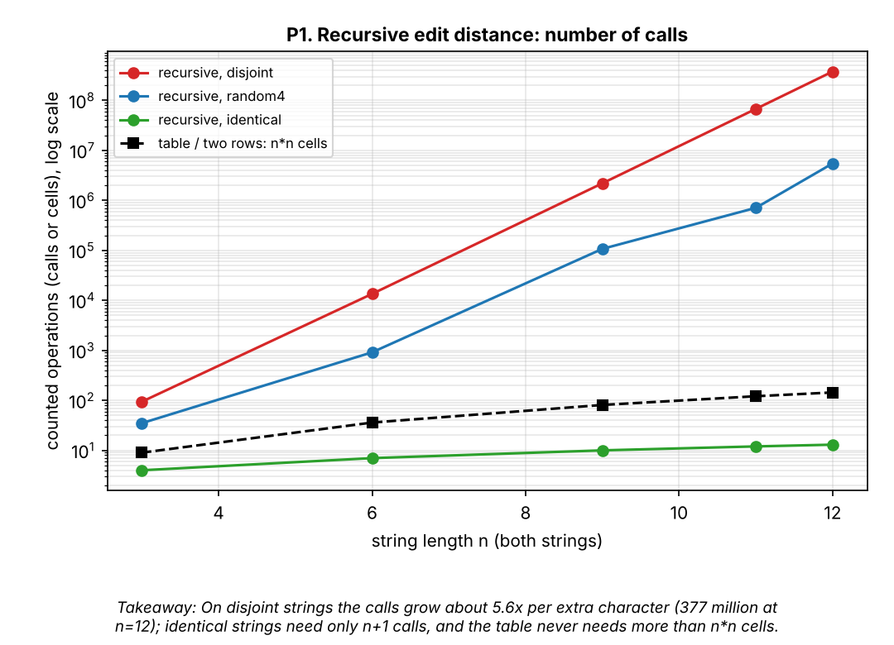
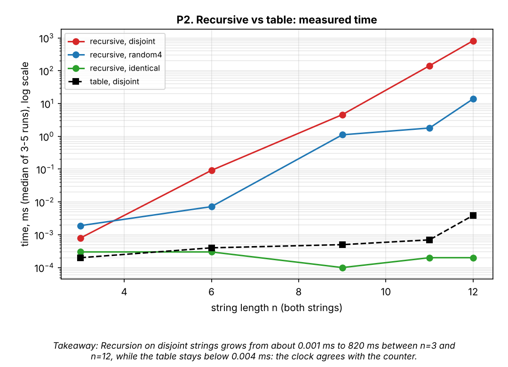
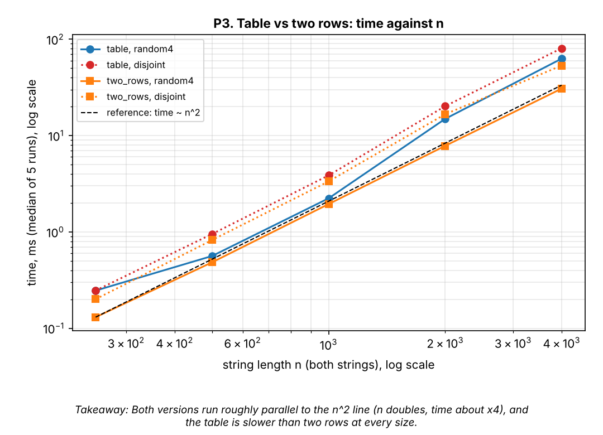
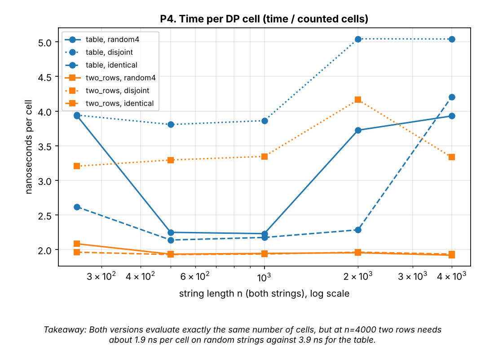
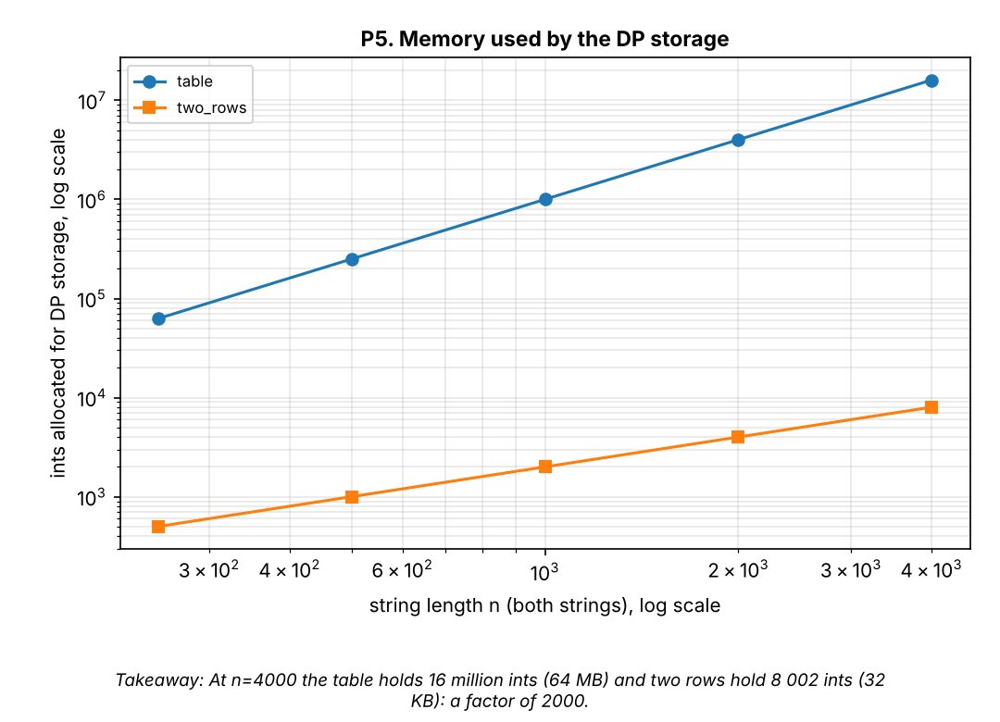
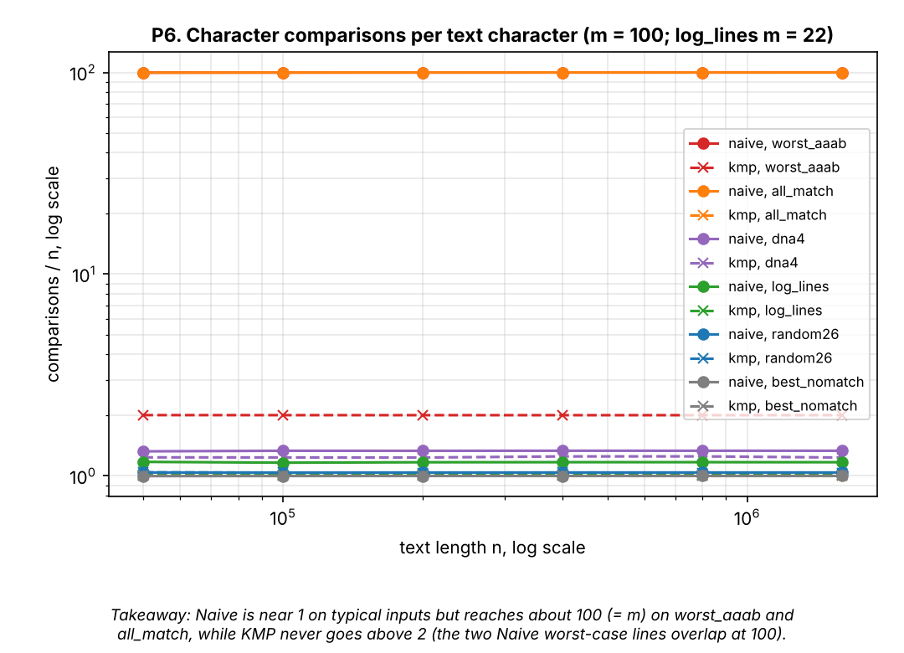
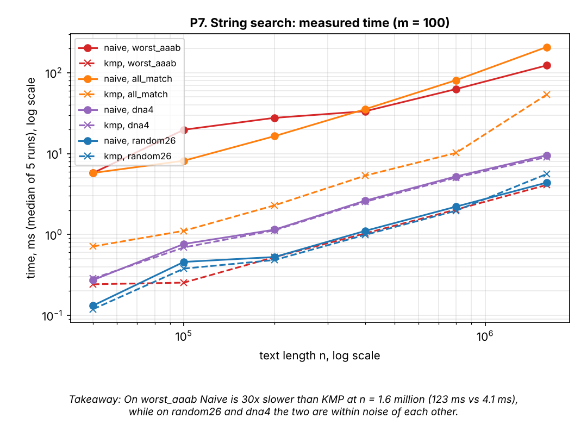
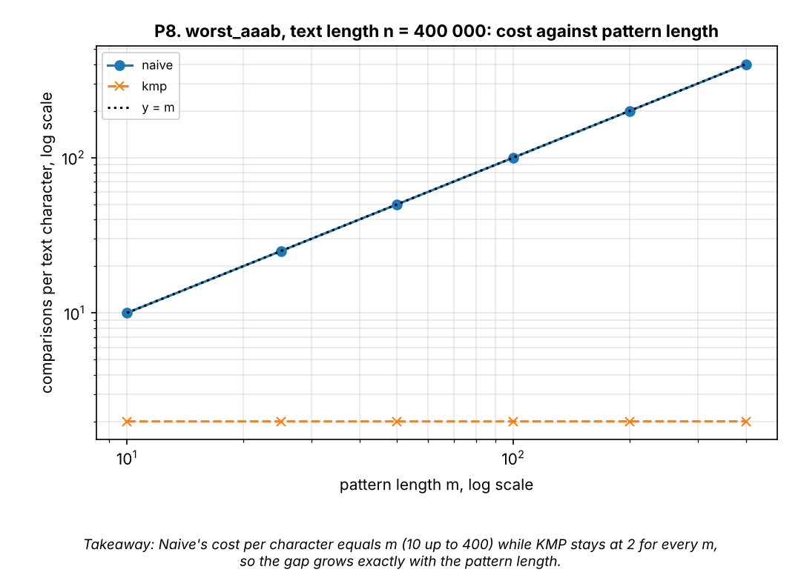

# Assignment 4: City Search & Spell-Check

Taubakabyl Nurlybek's course, *Design and Analysis of Algorithms*. Author: Yerzhanov Amanzhol SE-2526.

## 1. Experiment Design Card

*Written before the first run of the experiment (see git history: commit `docs(report): add experiment design card`).*

| Field | Content |
|---|---|
| **Question: Edit Distance** | (1) Does the number of calls of the recursive version grow exponentially, while Table and Two-rows stay at exactly n·m cells? (2) How much does the input type change the recursion? (3) Do two rows keep the speed of the full table while using far less memory? |
| **Question: String search** | (1) Does Naive cost grow like n·m on a worst-case input while KMP stays at most 2n comparisons? (2) On "normal" input (random text, log text) is KMP really better, or is Naive just as good? |
| **Sizes (n)** | **Recursive:** n ∈ {3, 6, 9, 11, 12} (both strings of length n). The largest is 4× the smallest. Every +1 in n multiplies the work by about 6 on the worst input, so n = 12 is about 10^8–10^9 calls (seconds), n = 13+ would take minutes, n = 20 would take days. **Table / Two rows:** n ∈ {250, 500, 1000, 2000, 4000}. 4000² = 16 M cells is tens of ms and 64 MB for the table; 250² is small but still measurable in fractions of a ms. **Search (text length):** n ∈ {50 000, 100 000, 200 000, 400 000, 800 000, 1 600 000} with pattern length m = 100 (KMP on 50 000 chars is already around 0.1 ms; 1.6 M for the largest Naive worst case is about 160 M comparisons). **Pattern-length sweep:** n = 400 000, m ∈ {10, 25, 50, 100, 200, 400}. |
| **Inputs: Edit Distance** | `random4`: two independent random strings over {A,C,G,T}; the "average" case. `identical`: a = b; the best case for recursion (the recursion walks straight down the diagonal). `disjoint`: a = "aaa…", b = "bbb…" with no equal characters; the worst case for recursion (all three branches are always taken). |
| **Inputs: Search** | `random26`: random text over 26 letters, random pattern; the typical spell-check/log case, mismatch on the first character most of the time. `dna4`: random text over {A,C,G,T}; mismatches come later, so Naive does more work per start. `log_lines`: fake server log (6 line templates, random ids) searched for `ERROR disk full code=7`; the realistic operator scenario. `best_nomatch`: text = a^n, pattern = b a^(m-1); Naive's best case (first comparison fails every time). `worst_aaab`: text = a^n, pattern = a^(m-1) b; Naive's worst case (m−1 characters match at every start, then a mismatch). `all_match`: text = a^n, pattern = a^m; every position matches (n−m+1 overlapping matches). |
| **Metrics** | **Edit Distance:** `ops` = recursive calls (A) or inner DP cells evaluated (B, C), because this is exactly the work that the theory counts; `mem_cells` = ints allocated for the DP storage (to answer the question about two rows); `time_ms` = median of 5 runs (3 for recursive n ≥ 11, where a run takes seconds). **Search:** `ops` = character comparisons (the unit of work in both algorithms; for KMP it includes the LPS build); `mem_cells` = extra ints (KMP: m); `time_ms` = median of 5 runs after warm-up. `result` = distance or number of matches (used to check that all algorithms agree during the experiment). |
| **Prediction** | **Recursive:** on `disjoint` the number of calls grows by a factor of about 5.8 (3+2√2) for every +1 in n, so a straight line with slope ≈ 0.77 on a log10 plot; `random4` is exponential too but with a smaller base; `identical` is linear (n+1 calls). **Table / Two rows:** `ops` is exactly n·m for every input; time grows ×4 when n doubles; Two rows is about as fast as Table (maybe slightly faster because of the cache) while `mem_cells` is (n+1)² vs 2(n+1). **Search:** on `worst_aaab` Naive does about m·n = 100·n comparisons and is tens of times slower than KMP; KMP stays between n and 2n comparisons on every input. On `random26` Naive does about 1.04·n comparisons and I expect it to be as fast as KMP or faster (KMP has extra work for the LPS array and the fallback logic); on `dna4` about 1.33·n. |
| **Plots** | P1: recursive calls vs n (log y) for three inputs + n² of the table: *how exponential is recursion and how much does the input matter?* P2: time vs n (log y) for recursive vs table: *is the exponential visible in the clock?* P3: Table vs Two rows, time vs n (log-log): *do both really scale as n²?* P4: ns per cell vs n: *does Two rows have a better constant?* P5: memory cells vs n (log-log): *what does the table cost in memory?* P6: comparisons per text character for Naive and KMP on every input (log y): *where does Naive blow up and is KMP bounded by 2?* P7: time vs n for Naive and KMP (log-log): *does the counter result show up in the clock?* P8: comparisons per character vs pattern length m on `worst_aaab` (log-log): *does Naive cost grow with m while KMP does not?* |

*Changes to the card after the runs: none.* All numbers below come from `results/results.csv` (JDK 21, one Linux container; counters are identical on every run, times are not).

## 2. Plots and Results

**P1.** On disjoint strings the recursive calls grow about 5.6x per extra character (377 million at n=12); identical strings need only n+1 calls, and the table never needs more than n·n cells.

**P2.** Recursion on disjoint strings goes from about 0.001 ms to 820 ms between n=3 and n=12, while the table stays below 0.004 ms: the clock agrees with the counter.

**P3.** Both DP versions run roughly parallel to the n² line (n doubles, time about x4), and the table is slower than two rows at every size.

**P4.** Both versions evaluate exactly the same number of cells, but at n=4000 two rows needs about 1.9 ns per cell on random strings against 3.9 ns for the table.

**P5.** At n=4000 the table holds 16 million ints (64 MB) and two rows hold 8 002 ints (32 KB): a factor of 2000.

**P6.** Naive is near 1 comparison per character on typical inputs but reaches about 100 (= m) on `worst_aaab` and `all_match`, while KMP never goes above 2.

**P7.** On `worst_aaab` Naive is 30x slower than KMP at n = 1.6 million (123 ms vs 4.1 ms), while on `random26` and `dna4` the two are within noise of each other.

**P8.** Naive's cost per character equals m (10 up to 400) while KMP stays at 2 for every m, so the gap grows exactly with the pattern length.

## 3. Prediction vs Result

**Edit Distance.**
- *Recursive, `disjoint`:* I predicted a factor of about 5.8 per extra character. I saw 5.55 per step between n=9 and n=11 and 5.59 from n=11 to n=12 (67.6 M → 377.4 M calls). The factor is slightly lower because the ratio of the sequence only approaches 3+2√2 ≈ 5.83 from below. Prediction confirmed.
- *Recursive, `identical`:* predicted n+1 calls; saw 4, 7, 10, 12, 13 calls. Confirmed.
- *Recursive, `random4`:* predicted "exponential, smaller base". This is the one surprise: the counts 35, 914, 107 101, 709 785, 5 479 308 grow irregularly (x2.6 per step from n=9 to n=11 but x7.7 from n=11 to n=12). The reason is that I used one random pair per n, and how many characters match decides how often the shortcut `a[i-1]==b[j-1]` removes two of the three branches; I would need several seeds per n to estimate the average growth. At n=12 the spread between inputs is already enormous: 13 calls (identical), 5.5 M (random), 377 M (disjoint).
- *Table / Two rows:* `ops` was exactly n·m for every input (62 500 for n=250 up to 16 000 000 for n=4000), as predicted. Time grew x256 for random4 between n=250 and n=4000 (a 16x larger n, so 16² = 256: perfect for the table, x236 for two rows). Single doublings are noisy (table, n=1000→2000: x6.7).
- *Two rows vs table speed:* I predicted "about as fast, maybe slightly faster". Result: 1.1x faster up to n=1000, but about 2x faster at n=2000–4000 (7.8 vs 14.9 ms and 30.7 vs 62.9 ms on random4). The gap is bigger than I expected. A likely reason is that the 64 MB table does not fit in the CPU caches and must be allocated and zeroed, while two rows (32 KB) stay in the cache; I did not measure cache behaviour, so this is a hypothesis, not a result. Memory matched the formula: (n+1)² vs 2(n+1) ints.
- *Another thing the counter cannot see:* with the same `ops`, `disjoint` is slower than `identical` for two rows (53 vs 31 ms at n=4000), because every cell takes the three-way `min` branch instead of a simple copy.

**String search.**
- *Naive on `worst_aaab`:* predicted about m·n = 100·n comparisons; saw 99.99·n (and exactly m·n for every m in P8). KMP: predicted at most 2n; saw exactly 2.000·n. Time: 123 ms vs 4.1 ms (x30) at n=1.6 M. Confirmed.
- *Typical inputs:* predicted 1.04·n for `random26` and 1.33·n for `dna4` for Naive; saw 1.040 and 1.333. KMP needed 1.039 and 1.23–1.25. The times of the two algorithms are within noise (for example 4.4 ms Naive vs 5.6 ms KMP at n=1.6 M on random26, but 3.7 ms KMP vs 4.4 ms Naive on log_lines), so on normal input neither algorithm is clearly faster.
- *Surprise, `all_match`:* KMP does only 1.0 comparison per character, yet its time is 53.6 ms, 13x more than on `worst_aaab` (4.1 ms) with the same n. The reason is the output: 1.6 million matches means 1.6 million boxed `Integer` objects in an `ArrayList`. The counter does not count output work. Naive on the same input took 207 ms.
- *Noise:* Naive on `worst_aaab` took 5.8, 19.7 and 27.7 ms for n = 50 k, 100 k, 200 k (expected x2 per step); at a few milliseconds JIT compilation and garbage collection are visible. The counter shows the clean x2.

## 4. Short Answers

**Which input made your string search slowest, and why?** In terms of counted work, `worst_aaab` and `all_match` are equal for Naive (about 100 comparisons per character, i.e. m). `worst_aaab` is the pure algorithmic worst case: with text a^n and pattern a^(m-1)b, at every start position Naive matches m−1 characters, fails on the last one, forgets everything and restarts one position later, so the cost is m·n. In wall-clock time `all_match` was the slowest (207 ms for Naive, 53.6 ms for KMP at n=1.6 M) because on top of the comparisons it has to store 1.6 million matches. KMP's slowest *comparison* input was `worst_aaab` at exactly 2n.

**How large an n could the recursive Edit Distance handle, and what stopped it?** On the worst input (`disjoint`) n=12 took 0.82 s (377 M calls); each extra character multiplies the time by about 5.8, so n=13 would take about 5 s, n=15 about 3 minutes, n=17 about 1.5 hours and n=20 about 12 days (extrapolated from the measured factor, not measured). On random strings n=12 takes only 14 ms, so random input would have hidden this limit. What stops the recursion is time, not memory or stack: the call depth is at most n+m = 24, but there are only (n+1)² = 169 different subproblems and the recursion solves them 377 million times.

**What do you gain and lose with two rows instead of the full table?** Gain: memory drops from (n+1)·(m+1) to 2(m+1) ints (16 008 001 vs 8 002 at n=4000, a factor of 2000), and in my runs it was also 1.1–2.2x faster. Loss: the table is needed to walk back and reconstruct *which* insertions, deletions and replacements were made, so with two rows I get only the number, not the edit script (Hirschberg's algorithm can recover it, but it is more complex). The code is also a little harder to read and to debug, since old rows are overwritten.

**Which string search for the city platform, and why?** KMP. On normal input it was as fast as Naive in my data (about 1.04 comparisons per character on random text, times within noise), and it costs only m extra ints for the LPS array. But operator logs can contain long runs of equal characters or repeated fragments, and then Naive is m times slower (x30 for m=100 in my measurements), while KMP is guaranteed to stay at 2n comparisons whatever the text contains. I prefer a bounded worst case to a small gain on average. For the spell-check of single street names the strings are short, and the right tool is Edit Distance with two rows rather than text search.

## 5. One Paragraph on Time

Measured times ranged from 0.0001 ms (tiny edit distances) to 820 ms (recursive n=12), 80 ms (DP n=4000), 4.1 ms (KMP on 1.6 M characters) and 207 ms (Naive on `all_match`). Each value is the median of 3–5 runs after one warm-up run, on a JVM with a JIT compiler and a garbage collector inside a container, so values of a few milliseconds are noisy (table x6.7 instead of x4 for one doubling; Naive x1.4 instead of x2) and they would be different on another laptop. The times also include the counter increments. That is why time is not my only evidence: the counters are exact and deterministic (I ran the whole experiment twice and the counters were identical, only the times differed), and they give the clean laws (n·m cells, about 5.6x per character, m·n versus 2n). But the counters also miss things that the clock sees: the output cost in `all_match`, the cache cost of the 64 MB table, and the cheaper branch for identical strings. The two kinds of evidence together are stronger than either alone.
